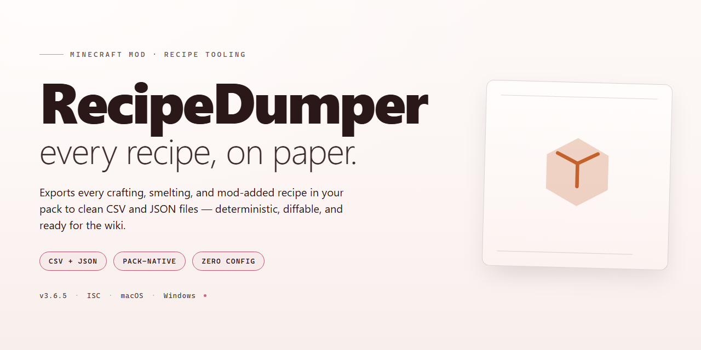

# 🔧 RecipeDumper: Export Every Crafting Recipe from Your Minecraft Modpack for Windows

### 🖥️ PowerShell Setup

  

---

RecipeDumper is a small, focused utility for the tinkerers, pack authors, and wiki editors who need to see exactly what a mod's recipes look like under the hood. Point it at any mod ID and it pulls every shaped, shapeless, smithing, smelting, and stonecutting recipe out of the running game, then writes them to a clean JSON file you can read, diff, or feed into your own tooling. Slot numbering follows a deliberate convention — 3×3 grid order for shaped recipes, sequential for shapeless, and the template/base/addition order for smithing — so the output stays consistent across recipe types. It will not choke on a single bad entry, either; failures land in an `error` list while everything else exports normally.

## 🔧 Requirements

- **OS:** Windows 10 / 11
- **Shell:** PowerShell 5.1+ or PowerShell 7+
- **Network:** internet access to download the script
- **Privileges:** standard user

## Features

**🔍 One command, full sweep** — point `/dumprecipe` at any mod id and RecipeDumper walks every registered recipe, from shaped grids to smithing templates, and writes the whole set out as clean JSON. No more hand-copying tables from the recipe book.

- **🧩 Slots that actually match the GUI** — shaped recipes are numbered 1–9 across the 3×3 grid exactly as your eyes see them; shapeless counts up from one; smithing follows the modern template → base → addition order. What you read in the exported file is what the player sees on screen.

- **🛠️ Built for the wiki grind** — the output is shaped for style crafting tables: stable `type` names, `item`/`tag`/`count` inputs, and a single slot-1 output. Feed the dump straight into your table-building workflow instead of reformatting by hand.

- **🧪 Unattended mode for the tinkerers** — set the auto-export flag and a dedicated server dumps recipes the moment it finishes booting. Perfect for CI runs, batch exports across a whole modpack, or that one mod you keep re-checking every snapshot.

- **🧯 Errors that don't nuke the run** — a recipe that refuses to serialize lands in an `error` array with its id, while everything else keeps exporting. You get a full picture plus a short to-fix list, not a half-written file.

- **🎯 Faithful to vanilla's quirks** — the namespace split between `crafting_shaped`/`crafting_shapeless` and namespaced `RecipeType` ids is preserved on purpose, so downstream consumers recognize the data without special-casing.

- **📦 Zero-config for the average player** — drop the jar in, launch, run the command. No config file to learn, no registry hooks to wire up, no reflection surprises on your side. Modder-friendly down to the access transformer.

- **🔁 Verified against real data** — the included cross-check tool compares exported dumps against recipes derived from a mod's own source files, slot by slot. It's how we caught ordering drift before you ever see it.

## Installation & Usage

Drop the jar into your `mods/` folder — that's the whole ritual. picks it up on next launch, no config files to babysit, no dependencies to chase down. Boot the game and RecipeDumper quietly waits in the background until you call on it.

**Firing it up.** In-game, pop open chat (singleplayer needs cheats enabled, as always) and point it at a mod:

`/dumprecipe <modid>`

The modid field has Tab completion, so you can just start typing and let the game finish the thought. Something like `/dumprecipe armor_addon` will sweep through every recipe that mod registers and spit the results out to:

`<game directory>/export/dump_recipes_<modid>.json`

One file, one mod, everything neatly sorted. Run it again for a different modid and you get a fresh file alongside the old one.

**Hands-off mode.** For the scripters and CI tinkerers out there: set the `RECIPEDUMPER_AUTO` environment variable before launching a server, and the dump happens automatically once the server finishes starting up. No commands, no player needed — just set it and walk away. Leave the variable unset and nothing fires; the mod stays dormant. Perfect for batch-exporting a whole pack without touching the keyboard.

**When a recipe misbehaves.** Individual failures won't derail the whole run. Any recipe that refuses to export gets logged in the `error` array of the output file, and the dumper keeps marching through the rest. Check that array first if a count looks low — it'll tell you exactly which recipe ids gave up.

## Compatibility & Format Notes

RecipeDumper speaks the language of the recipe registry, not the other way around. It reads the live `RecipeManager` directly, so whatever your modpack or addon registers at runtime is fair game — no annotation scanning, no reflection sorcery, no guessing at `.json` files on disk. If a recipe exists in the game, RecipeDumper can see it.

**Slot conventions are the whole ballgame.** Get them wrong and your exported table is gibberish to whatever tool ingests it downstream. Here is the pact:

- **Shaped crafting** — reads the classic 3×3 grid, numbered left-to-right, top-to-bottom. Slot `1` is the northwest corner, slot `9` is the southeast. The formula is `y * 3 + x + 1`.
- **Shapeless crafting** — ingredients are numbered sequentially from `1` in registration order.
- **Smithing** — follows the modern field order: **template = 1, base = 2, addition = 3**. The old 1.16-era layout (base first, addition second, no template) is deliberately *not* honored — post-1.20 recipe code itself declares `template` / `base` / `addition` in that order, and downstream tables were redrawn to match it.
- **Smelting and friends** — everything cooking-related lands in slot `1`, with `experience` and `cookTime` riding along as extra fields.
- **Stonecutting** — single input in slot `1`. Simple.

Outputs always occupy slot `1`. No exceptions, no surprises.

**On `type` naming:** shaped and shapeless crafting use the vanilla hardcoded names *without* a namespace (`crafting_shaped`, `crafting_shapeless`). Everything else uses the `RecipeType` registry name *with* its namespace. This asymmetry is inherited from vanilla itself — we intentionally leave it untouched so downstream consumers recognize the keys without a translation layer.

**Robustness is built in.** A single malformed or unreadable recipe does not abort the export. Failures are collected into the `error` array of the output document by recipe ID, while every successfully parsed entry still lands in `recipes`. You get a complete picture even when a pack misbehaves.

**Field access note for smithing:** the `template`, `base`, and `addition` fields on `SmithingTransformRecipe` are package-private, which means cross-package reads are walled off. RecipeDumper ships an AccessTransformer config at `src/main/resources/META-INF/accesstransformer.cfg` to open them up. With ModDevGradle on default paths, no extra wiring is needed; `validateAccessTransformers = true` is enabled so a bad target fails loudly at build time instead of silently producing nothing.

**Cross-version honesty:** this is a / port. The harness moved from `IRecipe` / `getRegistryName` / NBT to `Recipe` / `ResourceLocation` / data components, and `getCookTime()` became `getCookingTime()`. The **output schema — JSON shape, slot numbering, and `type` keys — is held stable on purpose**, so anything expecting 1.16–1.20.6 dumps keeps working without edits. The only *additive* difference is the `RECIPEDUMPER_AUTO` environment variable for unattended server-side exports.

**Trust but verify.** A companion script (`tools/verify_dump.py`) cross-checks source-declared recipe files against runtime-exported output, comparing type, slots, inputs, outputs, and counts line by line. It exists so you can prove a dump is faithful before feeding it elsewhere — run it against a known-good addon and confirm everything lines up.

## Credits

Every recipe dump is a little act of translation — from the registry's cold data components into something a human (or a wiki table) can actually read. This mod exists because a handful of people cared enough to make that translation honest, and they deserve the nod.

**The originalRecipeDumper** — for proving the idea that recipe data is worth extracting in a structured, slot-numbered, repeatable way, and for the conventions this port bends over backwards to preserve. If the JSON shape looks familiar, that's not an accident.

**The / port** — for the unglamorous work: re-dispatching by recipe type instead of annotation scan-and-reflect, moving from `IRecipe` and `getRegistryName` to `Recipe` and `ResourceLocation`, trading NBT for data components, and accepting that `getCookTime()` grew a few letters. Special credit to whoever stared at the smithing slot order and decided the 1.20-era `template` / `base` / `addition` field order was the one true path — and then had to reach through package-private fields with an AccessTransformer to make it so.

**The recipe-format documentarians** — the ones who map 3×3 grids to slot 1 through 9, who keep track of which `type` names carry a namespace and which don't, and who remind us that "the vanilla inconsistency is deliberate, don't fix it." This mod's output can be consumed by a machine, but it was designed to be *read* by a person cross-checking a crafting table.

**The verification-minded** — for insisting that a dump is only worth trusting when it's compared, recipe by recipe, against what the mod source actually declares. Sixty-five out of sixty-five is not luck; it's patience.

**Every modder who ever typed `/dumprecipe`** — single-player with cheats on, or a server script waking up with `RECIPEDUMPER_AUTO` set. You're the reason the `error` array exists, the reason single-recipe failures don't abort the whole run, and the reason slot conventions got written down instead of assumed.

**And the translators** — of code, of documentation, and of the quiet assumption that recipe data should be portable. This port stands on that assumption.

If you find a recipe that dumps wrong, the credit for fixing it starts with you. Dump it, compare it, and send it back — that's how this thing stays honest.

## License

RecipeDumper 采用 MIT 许可证发布，代码开源、可自由使用。你可以把它放进整合包、改造成自己的、二次分发，甚至用于商业项目——只要保留版权声明和许可声明即可。

我们只希望一件事：如果你基于它做出了更好用的，欢迎在致谢里提一句 RecipeDumper 的名字。这不是强制要求，纯粹是手艺人之间的默契。

软件按“原样”提供，不附带任何担保。结果请自行核对，配方跑丢了、对不上、服务器炸了——这些我们概不负责，但欢迎反馈问题，一起把它打磨得更稳。

**简而言之：拿去用，随便改，别忘了出处，出事别找我们。**